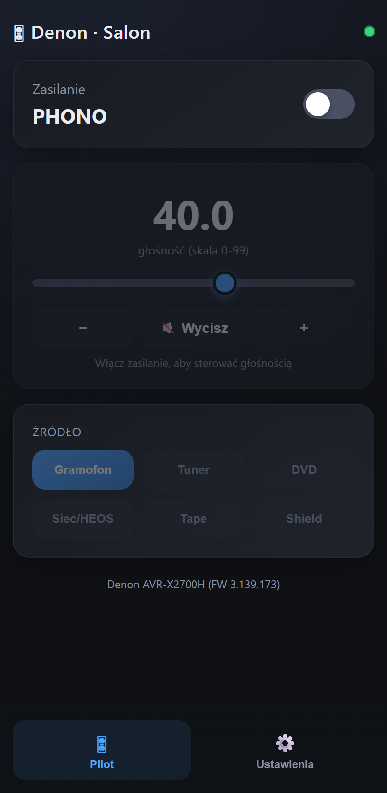
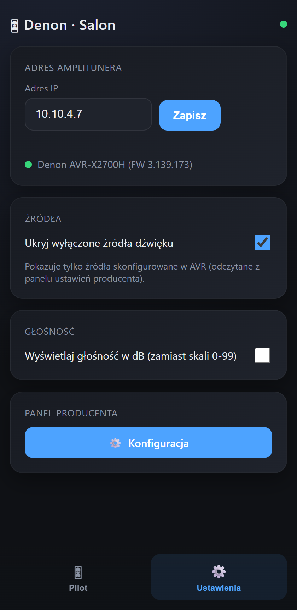

# Denon AVR Dashboard

Własny, responsywny dashboard/pilot (PWA) do amplitunerów Denon/Marantz,
zbudowany jako zamiennik toporownego natywnego panelu ustawień producenta.
Zasilanie, głośność, mute, wybór źródła — w czasie rzeczywistym, z pięknym
ciemnym UI, instalowalny na ekranie głównym telefonu.

 

## Dlaczego to powstało

Natywny panel webowy Denona (`https://<avr-ip>:10443/`) to w praktyce
**konfigurator ustawień**, nie pilot — pozwala tylko włączyć/wyłączyć strefę
i zmienić źródło z predefiniowanej listy, poprzez niewygodny XML/AJAX
interfejs zaprojektowany do rzadkiego użytku (setup wizard), nie do
codziennego sterowania głośnością z kanapy.

Po przeskanowaniu urządzenia odkryto, że amplituner udostępnia też
**klasyczny tekstowy protokół sterowania na porcie 23 (telnet)** — ten sam,
którego używają integracje Home Assistant, Control4 itp. — z pełną kontrolą
w czasie rzeczywistym (głośność, mute, źródło, zasilanie). Ten dashboard
jest cienką nakładką webową na ten protokół.

## Jak to działa (architektura)

```
┌─────────────┐      WebSocket/HTTP      ┌──────────────────┐      telnet :23       ┌───────────┐
│  Przeglądarka │ ◄──────────────────────► │ FastAPI backend  │ ◄────────────────────► │  Denon AVR │
│  (PWA, mobile)│                          │  (ten projekt)   │                        │            │
└─────────────┘                          └──────────────────┘                        └───────────┘
                                                   │  ▲
                                                   │  │ HTTP/HTTPS (jednorazowe odczyty)
                                                   ▼  │
                                      ┌──────────────────────────┐
                                      │ UPnP opis urządzenia :60006│ → dokładny model + FW
                                      │ AJAX panel ustawień :10443 │ → lista skonfigurowanych źródeł
                                      └──────────────────────────┘
```

1. **Backend (`app/main.py`, FastAPI)** utrzymuje **trwałe połączenie telnet**
   (port 23) do AVR. Wysyła zapytania stanu (`PW?`, `MV?`, `MU?`, `SI?`, `ZM?`)
   przy starcie i nasłuchuje asynchronicznie na zmiany stanu (także te
   wykonane z fizycznego pilota — AVR wypycha je sam).
2. Każdy klient przeglądarki łączy się przez **WebSocket (`/ws`)** i dostaje
   broadcast stanu przy każdej zmianie — nie ma pollingu.
3. Akcje (power/volume/mute/source) idą przez **REST POST**, backend
   tłumaczy je na komendy tekstowe telnet i wysyła do AVR.
4. Dodatkowe, jednorazowe/rzadkie odczyty (nie przez telnet):
   - **Model i wersja firmware** — z UPnP device description
     (`http://<avr-ip>:60006/upnp/desc/aios_device/aios_device.xml`),
     jedynego miejsca gdzie AVR podaje pełną nazwę modelu.
   - **Lista faktycznie skonfigurowanych źródeł** (do opcji "ukryj wyłączone
     źródła") — z natywnego panelu ustawień
     (`https://<avr-ip>:10443/ajax/globals/get_config?type=7`).
5. Konfiguracja (adres IP AVR, preferencje UI) jest **trwale zapisywana**
   do `data/config.json` (zamontowany wolumen Docker), więc przetrwa
   restart kontenera.

## Dokumentacja protokołu Denon (odkryta przez skan urządzenia)

### Port 23 — klasyczny protokół telnet (główny, używany przez ten dashboard)

Zwykły tekst, linie zakończone `\r`, bez autoryzacji. Zapytanie `XX?` zwraca
bieżącą wartość.

| Komenda wysyłana | Efekt |
|---|---|
| `PWON` / `PWSTANDBY` | włącz / standby |
| `ZMON` / `ZMOFF` | zasilanie głównej strefy |
| `MV<NNN>` | ustaw głośność (patrz niżej) |
| `MVUP` / `MVDOWN` | głośność +0.5 / −0.5 |
| `MUON` / `MUOFF` | wyciszenie |
| `SI<KOD>` | wybierz źródło, np. `SIPHONO`, `SICD`, `SITUNER`, `SIDVD`, `SIBD`, `SITV`, `SISAT/CBL`, `SIMPLAY`, `SIGAME`, `SIAUX1`, `SINET`, `SITAPE`, `SISHIELD`, `SIBT` |

**Ważna pułapka formatu głośności** — Denon koduje `MV` dwojako zależnie od
liczby cyfr:
- **2 cyfry** = liczba całkowita wprost, np. `MV40` → **40** (nie 4.0!)
- **3 cyfry** = krok połówkowy, ostatnia cyfra to dziesiąte części, np.
  `MV265` → **26.5**

Ten dashboard parsuje to poprawnie (`main.py::DenonClient._apply`); wiele
prostszych integracji ma tu błąd i dzieli zawsze przez 10.

Odpowiedzi odczytowe (przykłady z realnego urządzenia):
```
PW?  -> PWON
MV?  -> MV265 \r MVMAX 66      # MVMAX NIE jest dzielone przez 10
SI?  -> SIPHONO \r SVOFF
ZM?  -> ZMON \r SLPOFF
MU?  -> MUOFF
```

Nieprzetestowane na tym urządzeniu, ale standardowo dostępne w tym
protokole (do rozbudowy): `Z2ON`/`Z2OFF` (Zone 2), `Z3ON`/`Z3OFF` (Zone 3),
`MS<MODE>` (tryb surround), `CV<kanał> <poziom>` (channel trim),
`PSBAS`/`PSTRE` (bas/sopran), `NSxxx` (nawigacja NET/USB), `SLP<N>` (sleep
timer).

### Port 10443 — natywny panel ustawień (AJAX/XML)

Używany tylko do odczytu listy skonfigurowanych źródeł (opcjonalna funkcja
"ukryj wyłączone źródła").

```
GET  /ajax/globals/get_config?type=<N>    # odczyt
POST /ajax/globals/set_config             # zapis: type=<N>&data=<xml-urlencoded>
```

Kody `type` istotne: `4`=ZonePower, `7`=SourceList, `11`=System,
`3`=FriendlyName. Pełna lista i przykładowe odpowiedzi XML — patrz kod
źródłowy (`fetch_enabled_source_codes`).

### Port 60006 — UPnP device description

```
GET /upnp/desc/aios_device/aios_device.xml
```

Jedyne miejsce gdzie AVR zwraca pełną, czytelną nazwę modelu
(`<modelName>Denon AVR-X2700H</modelName>`) i wersję firmware
(`<firmware_version>3.139.173</firmware_version>`) — panel ustawień i
telnet tego nie udostępniają.

## API backendu (ten projekt)

| Endpoint | Metoda | Opis |
|---|---|---|
| `/` | GET | strona dashboardu (SPA) |
| `/ws` | WebSocket | broadcast stanu AVR na żywo |
| `/api/state` | GET | aktualny stan (`power`, `volume`, `volume_max`, `mute`, `source`, `zone_main`) |
| `/api/sources` | GET | lista dostępnych źródeł (filtrowana jeśli `hide_disabled_sources=true`) |
| `/api/device_info` | GET | `{model, firmware}` z UPnP |
| `/api/config` | GET | pełna konfiguracja (IP AVR, preferencje) |
| `/api/config` | POST | zapisz `avr_host`, `hide_disabled_sources`, `volume_display` (`"scale"`\|`"db"`) |
| `/api/power/{on\|standby}` | POST | zasilanie |
| `/api/mute/{on\|off}` | POST | wyciszenie |
| `/api/volume/{level}` | POST | ustaw głośność na wartość (skala AVR, nie dB) |
| `/api/volume_step/{up\|down}` | POST | głośność ±0.5 |
| `/api/source/{code}` | POST | wybierz źródło |

Wszystkie endpointy zmieniające stan (`volume`, `volume_step`, `source`,
`mute`) zwracają `{"ok": false, "error": "Zasilanie wylaczone"}` i nic nie
wysyłają do AVR, gdy urządzenie jest w standby.

## Funkcje

- Zasilanie, głośność (suwak + kroki), wyciszenie, wybór źródła — live,
  real-time przez telnet
- Status połączenia z zieloną/czerwoną kropką + nazwa modelu i FW, odczytane
  z urządzenia
- Zakładka **Ustawienia**: adres IP AVR (port zaszyty na stałe — zawsze 23),
  checkbox "ukryj wyłączone źródła" (porównuje z realną listą skonfigurowaną
  w AVR), checkbox "głośność w dB zamiast skali 0-99", przycisk z linkiem
  do natywnego panelu producenta
- **PWA**: manifest + service worker + ikony — instalacja na ekran główny
  telefonu (Android/Chrome pokazuje prompt; iOS/Safari — ręcznie przez
  "Dodaj do ekranu głównego")
- W pełni responsywny, ciemny motyw

## Instalacja (Docker Compose)

Wymagania: Docker + wtyczka `docker compose`, dostęp sieciowy do AVR
(port 23 telnet musi być osiągalny z hosta Dockera).

```bash
git clone https://github.com/KlimasTech/denon-dashboard.git
cd denon-dashboard/app
docker compose up -d --build
```

`docker-compose.yml`:
```yaml
services:
  denon-dashboard:
    build: .
    image: denon-dashboard:latest
    container_name: denon-dashboard
    restart: unless-stopped
    ports:
      - "7777:7777"
    environment:
      - AVR_HOST=10.10.4.7   # domyślny adres AVR — zmienialny potem w Ustawieniach
      - AVR_PORT=23          # ignorowane po starcie, port jest zaszyty na stałe
    volumes:
      - ./data:/app/data     # trwała konfiguracja (IP, preferencje)
```

Otwórz `http://<adres-hosta>:7777/`. Przy pierwszym uruchomieniu wejdź w
**Ustawienia** i wpisz prawidłowy adres IP amplitunera, jeśli różni się od
domyślnego z `AVR_HOST`.

### Zmienne środowiskowe

| Zmienna | Domyślna | Opis |
|---|---|---|
| `AVR_HOST` | `10.10.4.7` | adres IP AVR użyty przy **pierwszym** starcie (gdy `data/config.json` jeszcze nie istnieje) |
| `AVR_PORT` | `23` | nieużywane po starcie — port telnetu jest zaszyty na stałe w kodzie |
| `DATA_DIR` | `/app/data` | katalog na trwałą konfigurację |

### Bez Docker Compose (ręcznie)

```bash
cd app
pip install -r requirements.txt
AVR_HOST=10.10.4.7 uvicorn main:app --host 0.0.0.0 --port 7777
```

## Struktura projektu

```
app/
├── main.py              # backend FastAPI + klient telnet + integracje HTTP
├── requirements.txt      # fastapi, uvicorn, httpx
├── Dockerfile
├── docker-compose.yml
├── data/                 # (powstaje w runtime) trwała konfiguracja
└── static/
    ├── index.html        # frontend SPA (Pilot + Ustawienia)
    ├── manifest.json      # PWA manifest
    ├── service-worker.js
    └── icons/             # ikony PWA (192/512/maskable)
docs/
└── screenshots/
```

## Znane ograniczenia

- Serwowane po plain HTTP — Chrome wymaga HTTPS/localhost dla pełnych
  kryteriów instalacji PWA; na LAN po HTTP prompt instalacji może się nie
  pojawić w zależności od przeglądarki/urządzenia.
- HEOS CLI (porty 60006/1255, JSON) nie jest wykorzystywany — brak
  "now playing" dla źródeł streamingowych (NET/HEOS Music).
- Surround mode, tony (bas/sopran), Zone 2/3 — niewykorzystane, choć
  protokół telnet je obsługuje (patrz sekcja protokołu wyżej).
- Testowane na Denon AVR-X2700H (FW 3.139.173). Powinno działać na innych
  modelach Denon/Marantz z tym samym protokołem telnet, ale kody źródeł
  (`SI<KOD>`) mogą się różnić w zależności od modelu.

## Licencja

MIT
